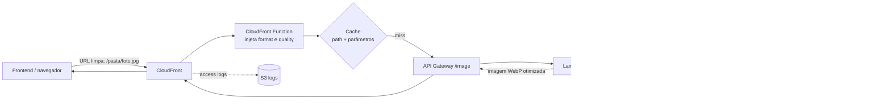

# Arquitetura

## Fluxo

1. O frontend pede somente o caminho da imagem usando o domínio retornado por `terraform output image_endpoint`.
2. A CloudFront Function adiciona os padrões configurados (`format` e `quality`) sem alterar as dimensões antes da busca no cache.
3. Em cache miss, CloudFront chama o API Gateway, que aciona a Lambda de telemetria.
4. A telemetria obtém o tamanho original no S3, chama a Lambda de transformação e publica `OriginalBytes`, `OptimizedBytes`, `SavedBytes` e `SavedPercent` via Embedded Metric Format.
5. A resposta fica em cache por caminho e parâmetros.

O bucket de origem é externo ao Terraform e não é removido por `terraform destroy`.
